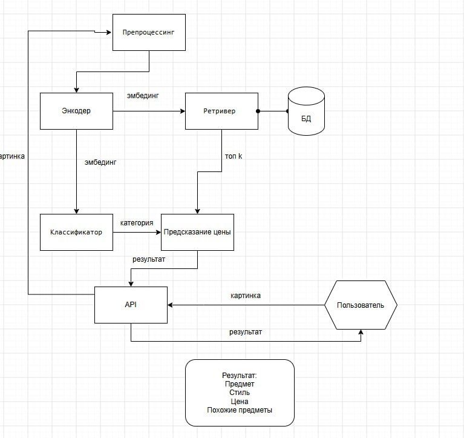

# vintage-estimator

Проект: оценка антиквариата по фото

## Команда проекта:
@kustarevv - https://github.com/Kustarevvv  
@SatoriTanabi - https://github.com/Satori-Tamaba

## Схема проекта:

Зона ответственности:
Препроцессинг энкодер, классификатор - Зеленин Денис  
Ретривер, предсказание цены api - Кустарев Александр

## Структура проекта

```
src/vintage_estimator/
├── schemas.py          # общие типы данных между модулями
├── preprocessing/
├── encoder/
├── classifier/
├── retriever/
├── price_prediction/
└── api/                 # собирает пайплайн: estimate(image) -> результат
tests/
```

Подробнее про контракты между модулями — в `project_structure.md`.

## Запуск

Из корня проекта (Python 3.11+):

```powershell
python -m pip install -e ".[dev,serve]"
python -m pytest -q
```

Для поиска по своим данным сначала подготовьте CSV и фотографии через
`data_pipeline/parse.py`, затем посчитайте каталог:

```powershell
python data_pipeline/build_embeddings.py
python -m vintage_estimator photo.jpg --catalog-dir data --top-k 5
```

Для обработки результата скриптом добавьте `--json`: stdout будет содержать
JSON с категорией, стилем, ценой и аналогами. Отсутствующая цена передаётся
как `null`, известная нулевая — как `0`. Без флага сохраняется обычный вывод.
CLI приводит фото к RGB. Ошибки чтения фото и загрузки каталога выводятся
в stderr с кодом завершения 1; неверные аргументы — с кодом 2.

Формат каталога: `embeddings.npz` с ключом `embeddings` (N×512) и
`embeddings_metadata.csv` с N строками в том же порядке. Обязательные поля:
`lot_id`, `price`; для резервной оценки — `canon_category` (или `category`
для старого CSV). `title` и `image_url` необязательны. Пустая цена допустима.
Файлы создаёт `build_embeddings.py`, вручную переставлять строки CSV нельзя.

HTTP-сервис загружает каталог один раз при запуске:

```powershell
$env:VINTAGE_CATALOG_DIR = "data"
python -m uvicorn vintage_estimator.api.app:app
```

Откройте `http://127.0.0.1:8000/docs` и отправьте фото через `POST /estimate`.
Параметр `POST /estimate?top_k=10` задаёт число аналогов: от 1 до 100,
по умолчанию 5. Некорректное значение возвращает HTTP 422.
ML-пайплайн выполняется в пуле потоков, освобождая event loop сервера.
Пул общий для приложения; лимит параллельного inference и расход памяти GPU
пока отдельно не настроены.
Если путь указан, но каталог отсутствует или повреждён, сервис не запустится.
Без настройки каталога доступны классификация и пустой список аналогов.
`price: null` означает, что данных для оценки пока нет; `price: 0` — известная
нулевая цена. Цена — ориентир по каталогу, не экспертная оценка.

Первая обработка изображения загружает веса CLIP (около 350 МБ).
Быстрые тесты не скачивают веса. Проверка настоящего пути
фото → CLIP → классификатор → FAISS → цена → HTTP:

```powershell
python -m pytest -q -m slow tests/test_catalog_integration.py
```

Тест создаёт временный каталог с настоящими эмбедингами тестовой картинки.
Он проверяет соединение модулей, а не точность оценки на антиквариате.
Для всех тестов, включая ML, используйте `python -m pytest -q -m "slow or not slow"`.

Разбор текущего состояния и дальнейший план: [docs/project_review.md](docs/project_review.md).

